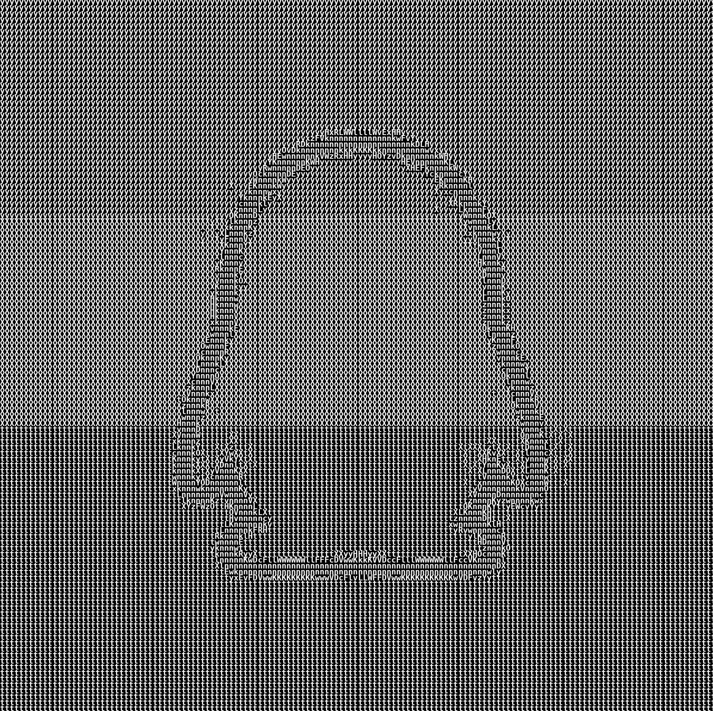

# astrbot_plugin_ascii

把**图片、QQ 头像**一键转成 ASCII 字符画并回发的 [AstrBot](https://github.com/AstrBotDevs/AstrBot) v4 插件，面向 `aiocqhttp` / NapCat 链路。

<table>
  <tr>
    <td align="center"><br><sub>输入：QQ 头像</sub></td>
    <td align="center"><br><sub>输出：ASCII 字符画</sub></td>
  </tr>
</table>

> 仓库目录名必须是 `astrbot_plugin_ascii`（下划线），与 `metadata.yaml` 的 `name` 一致，AstrBot 才能把它当作可导入的插件模块。

---

## 它能做什么

| 指令 | 行为 |
| --- | --- |
| 图片 + `/ascii`（或 `/字符画`） | 转换这张图片 |
| `/ascii @某人` | 抓取被 @ 成员的 QQ 头像再转换 |
| `/ascii 123456` | 抓取该 QQ 号的头像再转换 |
| 单发 `/ascii` | 取同一会话内这个人最近 60 秒发过的一张图 |

图片来源优先级：**当前消息附带的图片 > `@成员` / QQ 号头像 > 最近图片缓存**。`@全体成员` 和 `@机器人自己` 不会被误当成头像目标。

支持黑白 / 彩色、黑底 / 白底、字符列数、比例修正、输出尺寸、超时等，全部可以在 AstrBot WebUI 的插件配置页里改，无需改代码。

---

## ⚠️ 必读：本插件依赖一个外部仓库

**上游项目：https://github.com/vietnh1009/ASCII-generator**

本仓库 **不附带** 上游的 Python 脚本、字体或 demo 素材。插件在运行时用 `asyncio.create_subprocess_exec()` 启动上游的 `img2img.py` / `img2img_color.py`：

```
AstrBot 进程
   └─ 子进程: <python_path> img2img.py --input ... --output ... --num_cols ... --language english --background ...
        cwd = <generator_dir>          （上游用相对路径读 fonts/，所以工作目录必须是这里）
```

所以这里的「连接」**不是 HTTP API、不是 pip 依赖、也不能跨机器**，而是**同一台机器上的本地子进程调用**。要让插件工作，必须：

1. 单独把上游 ASCII-generator 装到 AstrBot 进程能读到的目录；
2. 在 WebUI 把 `generator_dir` 指向该目录、把 `python_path` 指向装了 `numpy` / `opencv` / `Pillow` 的解释器。

> 完整步骤（稀疏克隆、Pillow 12 兼容补丁、字体、Docker 场景、故障排查）见 **[docs/SETUP.md](docs/SETUP.md)**。

---

## 快速开始

### 1. 安装上游生成器

```bash
git clone --depth 1 --filter=blob:none --sparse \
  https://github.com/vietnh1009/ASCII-generator.git /opt/ASCII-generator
git -C /opt/ASCII-generator sparse-checkout set --no-cone \
  '/*.py' '/README.md' '/LICENSE' '/fonts/DejaVuSansMono-Bold.ttf'

# Pillow >= 10 必做：上游仍在用已移除的 ImageFont.getsize()
# 在本仓库根目录执行；git -C 会切换工作目录，patch 路径必须写成绝对路径
PATCH="$(pwd)/patches/pillow12-getsize.patch"
git -C /opt/ASCII-generator apply "$PATCH"
```

也可以用随仓库提供的脚本（不会删除任何已有文件）：

```bash
PYTHON_BIN=/opt/AstrBot/venv/bin/python \
  ./scripts/install_generator.sh /opt/ASCII-generator --apply-patch
```

### 2. 安装插件

```bash
cd /opt/AstrBot/data/plugins
git clone https://github.com/yunsjxh/astrbot_plugin_ascii.git astrbot_plugin_ascii
```

### 3. 在 WebUI 里连起来

进入 **插件管理 → 已安装 → ASCII 字符画 → 配置**，填写（默认值即为下列路径）：

| 配置项 | 示例值 | 说明 |
| --- | --- | --- |
| `generator_dir` | `/opt/ASCII-generator` | 上游脚本与 `fonts/` 所在目录，同时作为子进程 `cwd` |
| `python_path` | `/opt/AstrBot/venv/bin/python` | 需已安装 `numpy`、`opencv`、`Pillow`；直接复用 AstrBot 自己的虚拟环境最省事 |

保存后**在 WebUI 点一次「重载」插件**，配置和新代码才会进入运行中的进程。刚上传/克隆完插件时也需要这一次重载，否则插件列表里可能看不到它。

### 4. 验证

QQ 里发一张图片并附 `/ascii`；或试 `/ascii @某位群友`、先发图再单发 `/ascii`。

---

## 配置项

定义在 `_conf_schema.json`，会由 AstrBot 自动渲染成 WebUI 表单；已保存的值写在 `data/config/astrbot_plugin_ascii_config.json`（可能带 UTF-8 BOM）。

| 键 | 类型 | 默认 | 说明 |
| --- | --- | --- | --- |
| `num_cols` | int | `100` | 字符画宽度（列数），建议 60~150，上限 300 |
| `recent_image_ttl` | int | `60` | 单发指令回溯最近图片的秒数；`0` 关闭，上限 600 |
| `fix_aspect_ratio` | bool | `true` | 修正上游把图案横向拉宽约 1.6 倍的问题 |
| `keep_original_size` | bool | `false` | 把输出缩回原图像素尺寸（小图上字符会变糊，默认关） |
| `color` | bool | `false` | 使用 `img2img_color.py` 输出彩色字符画 |
| `white_background` | bool | `false` | 白底黑字；关闭为黑底白字 |
| `timeout` | int | `30` | 单次转换超时（秒），下限 5 |
| `generator_dir` | string | `/opt/ASCII-generator` | 上游安装目录 |
| `python_path` | string | `/opt/AstrBot/venv/bin/python` | 运行上游脚本的解释器 |

> 配置优先级：WebUI 已保存的显式值会覆盖代码默认值。升级插件后若行为没变，先确认配置页里的旧值（尤其是 `keep_original_size`）并重新保存。

也可以直接编辑配置文件：

```json
{
  "num_cols": 100,
  "recent_image_ttl": 60,
  "fix_aspect_ratio": true,
  "keep_original_size": false,
  "color": false,
  "white_background": false,
  "timeout": 30,
  "generator_dir": "/opt/ASCII-generator",
  "python_path": "/opt/AstrBot/venv/bin/python"
}
```

改完仍需重载插件。

---

## 实现要点

- **比例修正**：上游用 `cell_height = 2 * cell_width` 采样，却按 `char_height` 行距绘制，输出宽高比被放大 `2 * char_width / char_height`。本插件读取 `fonts/DejaVuSansMono-Bold.ttf` 的 `getbbox("A")` 动态算出该系数（该字体为 `12 / 15` → `1.6`），转换前把输入图纵向预拉伸来抵消，输出保持原生字符大小的大图，字符既清晰又不变形。
- **跨容器发图**：上游写出的是本地文件，但 NapCat 常跑在另一个容器里，路径不共享。插件读取结果字节后用 `Image.fromBytes()` 回发，`aiocqhttp` 适配器会自动编码成 `base64://`。
- **头像抓取**：`https://q1.qlogo.cn/g?b=qq&nk={uin}&s=640`，通过 AstrBot 的 `MediaResolver` 下载，10 秒超时，失败时返回提示而不发坏图。这是插件里唯一需要公网出网的动作。
- **最近图片缓存**：被动监听 `aiocqhttp` 的每条消息，缓存的是**图片字节**而非文件路径（AstrBot 会在事件结束后清理临时文件）。键为 `会话:发送者`，TTL 用 `time.monotonic()` 从发图时刻计算，单发指令不续期；单图上限 20 MB、最多 256 条。
- **并发与超时**：转换用 `asyncio.Lock` 串行化，固定输出文件避免堆积临时文件；子进程超时会 `kill` 并给出提示。

---

## 已知限制

- 上游生成器必须与 AstrBot **同机同文件系统**，不能指向另一台主机或仅挂载到 NapCat 容器。
- 插件固定传 `--language english`，因此 `fonts/DejaVuSansMono-Bold.ttf` 必需；上游仓库里的中/日/韩字体（`simsun.ttc`、`arial-unicode.ttf`）涉及商业字体授权，本项目未安装、也不分发。
- 最近图片缓存是**进程内存**，AstrBot 重启后清空。
- 群聊里必须把指令放前面：`/ascii @某人` 有效，`@某人 /ascii` 会被 AstrBot 的唤醒规则拦下。
- 上游视频脚本的 XVID 编码丢帧问题不属于本插件范围（插件只调用图片脚本）。
- 仅在 AstrBot v4.28.1 + aiocqhttp + NapCat 上验证过。
- 文档中的 `/opt/...` 均为示例路径，请按自己的部署调整；上游与 AstrBot 必须能访问同一个本地目录。

---

## 许可证与致谢

- 本仓库代码：**MIT**，见 [LICENSE](LICENSE)。
- 上游 [vietnh1009/ASCII-generator](https://github.com/vietnh1009/ASCII-generator)：MIT，Copyright (c) 2018 Viet Nguyen。本项目不含其代码，运行时单独安装；版权声明与许可全文见 [NOTICE](NOTICE)。
- 字体 `DejaVuSansMono-Bold.ttf` 来自 [DejaVu Fonts](https://dejavu-fonts.github.io/)，随上游安装获得，不在本仓库内。
- QQ 头像来自腾讯 `q1.qlogo.cn` 服务，本项目不重新分发头像图片（仓库 `assets/` 内为测试用的公开默认头像及其转换结果）。

---

## 维护清单

本仓库按 `yunsjxh/astrbot_plugin_ascii` 发布，以下信息已固定；Fork 或变更作者时记得同步修改：

- [x] `metadata.yaml` 的 `repo` / `author` → `yunsjxh`
- [x] `LICENSE` 版权行 → `Copyright (c) 2026 yunsjxh`
- [x] README 与 `docs/SETUP.md` 中的仓库名、补丁路径示例均已换成真实地址，无遗留占位符
- [x] `main.py` 的 `@register` 作者与仓库链接指向本仓库
- [ ] 改动 `main.py` / `_conf_schema.json` 后，在 AstrBot WebUI 保存配置并「重载」插件
- [ ] 升级上游 ASCII-generator 后，重新确认 `patches/pillow12-getsize.patch` 是否仍适用
- [ ] 在 AstrBot 插件市场 / 社区发布时附上 `docs/SETUP.md` 链接，说明上游依赖不是可选的
